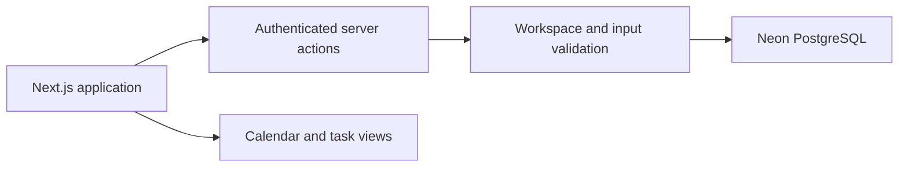

# Tandem

**A shared calendar and task planner designed to turn two people's moving schedules into one clear plan.**

Tandem is a full-stack collaboration product for managing events, planned work, and everyday responsibilities. Its central design goal is to make a shared plan easier to understand and act on without sacrificing individual accountability.

[**Explore the live application**](https://tandem-planner.vercel.app) (sign-in required)

**Project type:** Full-stack product | **Stack:** Next.js, TypeScript, React, Neon Auth, PostgreSQL, Drizzle, Vercel

## The problem

Calendars answer **when something is happening**. Traditional task lists answer **what needs doing**. Tandem connects those decisions in one authenticated workspace so people can coordinate commitments and revisit the plan as priorities change.

## What the application does

- **Shared calendar:** Manage events, including recurring schedules, across several calendar views.
- **My List — Week:** Drag or assign tasks into a Monday–Sunday plan with a separate planned date from the task deadline.
- **My List — Backlog:** Keep work visible without forcing every task onto the calendar.
- **My List — Matrix:** Organize work into four explicit priority quadrants and an unclassified inbox.
- **Shared coordination:** Assign tasks, maintain workspace membership, and track selected changes in an activity summary.
- **Cross-device use:** Responsive layouts for desktop and mobile planning.

## Engineering decisions

**One data model, multiple views.** Week, Backlog, and Matrix use the same task records. Planned dates, deadlines, priorities, and ordering represent different decisions and should not be silently inferred from one another.

**Authentication and authorization stay server-side.** Neon Auth handles identity; application code validates workspace access before reading or changing shared data.

**State stays durable.** Tasks and events live in Neon PostgreSQL through Drizzle ORM. Task movement is designed to support persisted ordering and rollback if a write fails.

**Complex calendar behavior is explicit.** Workspace timezone and recurrence handling are centralized instead of scattered throughout UI components.

## Architecture



## Quality and status

The live application is deployed to Vercel. The repository includes TypeScript checks, ESLint, Vitest tests, and a GitHub Actions CI workflow. Authenticated Playwright tests require dedicated test credentials and environment setup; passing unit tests alone does not establish complete production coverage.

## Run locally

Requires Node.js 22.13+, pnpm 11, and a configured Neon database/Auth project. Use the provided `.env.example` and keep credentials out of version control.

```bash
pnpm install
pnpm db:migrate
pnpm dev
```

To run existing checks:

```bash
pnpm lint
pnpm typecheck
pnpm test
```

Only apply migrations to an appropriately provisioned development database. Do not run historical migrations against the live production database without verifying the current schema and migration history.

## Next improvements

Strengthen deployment-to-repository traceability, expand authenticated end-to-end coverage, improve offline behavior, and document the product through visual walkthroughs.
